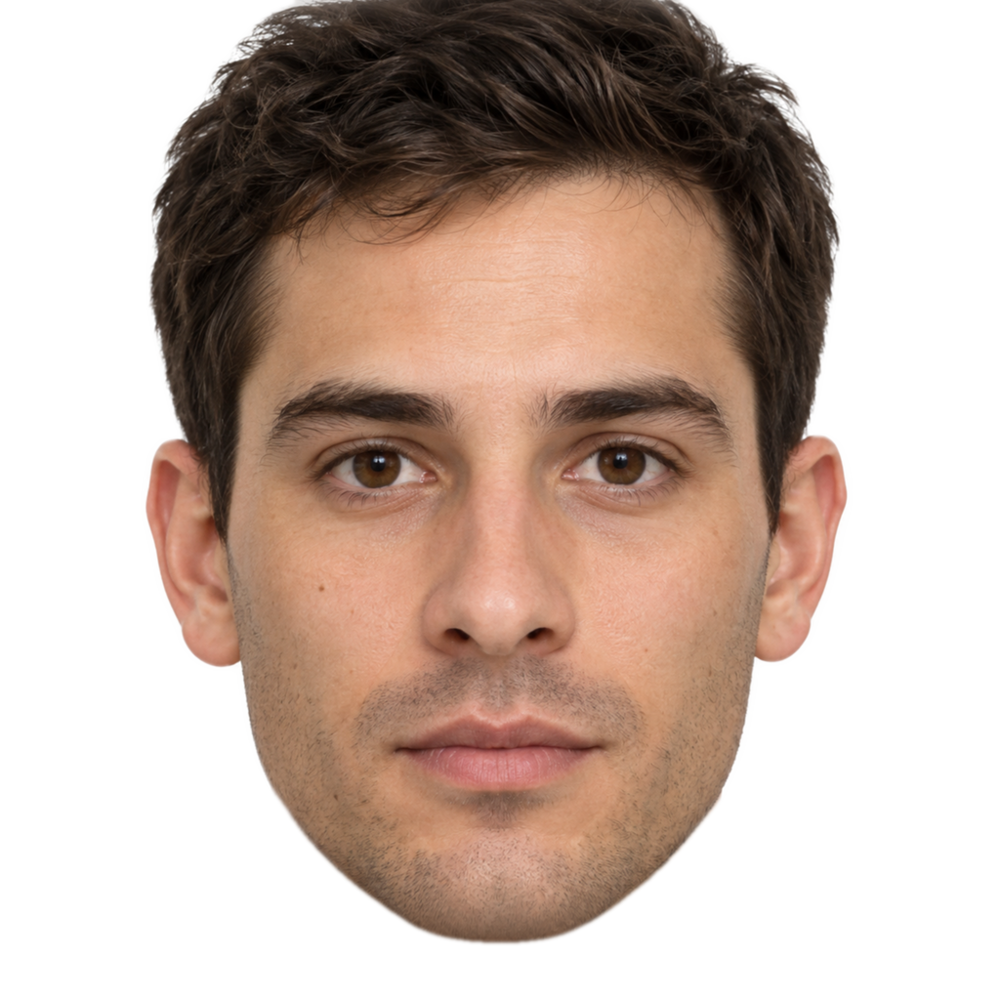
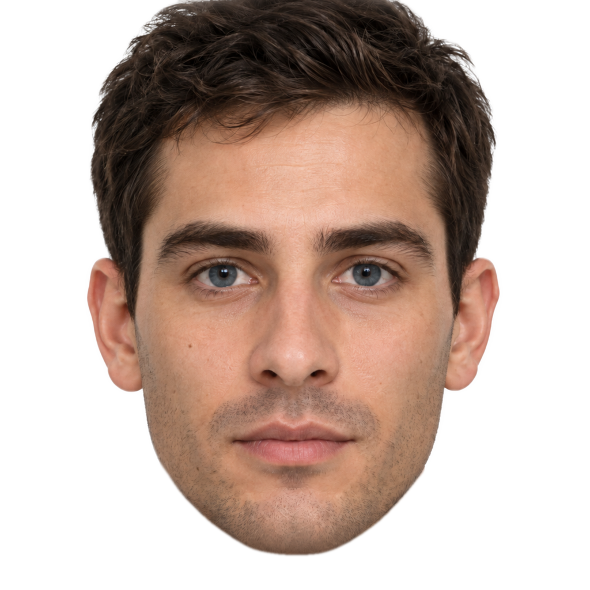
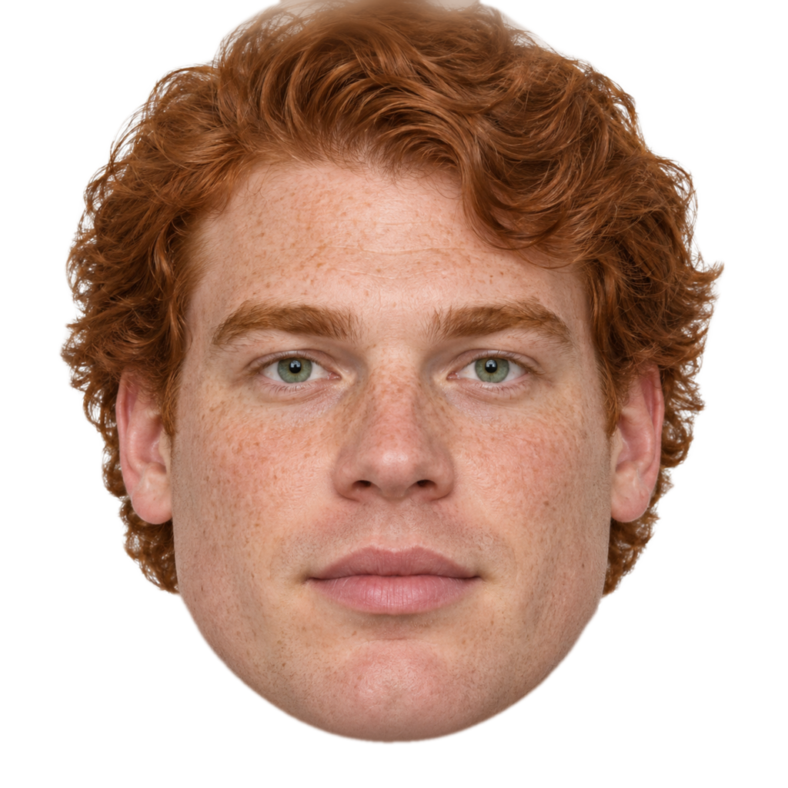

# AlignFace

**Human-Aligned Face Similarity Metric with Interpretable Concept Relations**  
Ying Huang, Wencan Zhang, Brian Y. Lim · National University of Singapore

**ACM Multimedia 2026**

[Project website](https://yyyinghuang.github.io/AlignFace/) · [Paper](https://arxiv.org/pdf/2608.14130) · [Technical guide](docs/usage.md)

This working tree integrates the research website and Python inference package. Code licensing and weight redistribution review are still pending; see [license and third-party notices](#license-and-third-party-notices).


Face similarity with 20 interpretable concepts. Score one pair, process batches,
or use AlignFace as a frozen metric in your training loop.

## Get the code and install

Python 3.10 and Git LFS are required for the source release with bundled weights.
The commands below apply once this release is merged and its LFS weights are uploaded:

```bash
git lfs install
git clone https://github.com/yyyinghuang/AlignFace.git
cd AlignFace
git lfs pull
python -m pip install -e .
```

Already downloaded the release ZIP? Enter its `open-source` folder and run
`python -m pip install -e .`. Model weights are included; no API key is needed.

## First test

```bash
python examples/quickstart.py --verify
python -m unittest discover -s tests -v
```

The demo compares three synthetic faces:

- **A:** reference; **B:** edited variation; **C:** different face.
- Default scores: **A–B ≈ 0.9692**, **A–C ≈ 0.5264**.
- Successful verification prints `PASS`.

  

## Score a pair or batch

```python
from alignface import AlignFace

metric = AlignFace.from_pretrained("overall")
print(metric.compare("a.jpg", "b.jpg").similarity)
print(metric.compare("a.jpg", "b.jpg", concept="eye color").similarity)

pairs = [("a.jpg", "b.jpg"), ("a.jpg", "c.jpg")]
results = metric.compare_batch(pairs, batch_size=16)
scores = [r.similarity for r in results]  # Same order as pairs
print(results[0].concepts)               # similarity + global weight
```

- `level="concept"` returns all concepts; `metric.concept_names` lists their names.
- **Models:** `overall`, `asian`, `white`.
- **Backbones:** `flip` (default), `clip`.
- **Input:** aligned, masked face images; [raw-photo preprocessing](docs/usage.md#preprocessing-before-editing) is available separately.

## Use in training

`compare_batch()` returns detached scores for evaluation or teacher labels.
For gradients to an image-generating model, use tensor batches:

```python
# reference/generated: aligned RGB tensors [B,3,H,W] in [0,1].
# generated must retain the graph from your own model.
scores = metric.score_tensors(
    metric.prepare_tensors(reference),
    metric.prepare_tensors(generated),
)  # [B], with input gradients; AlignFace weights stay frozen
loss = (1 - scores).mean()
loss.backward()
```

Pass `concept="eye color"` for a concept loss, or `level="concept"` for `[B,20]`.
For a smoother face loss, use `calibration="sigmoid"`. Run the complete example:

```bash
python examples/training_step.py
```

All similarities are in `[0,1]`, higher means more similar. Default face scores
use a fixed reference percentile and preserve raw-score order; they are not match
probabilities. **Pair-level GAM inference is experimental.** Gradient support
does not establish downstream training effectiveness.

[Technical details and training guidance](docs/usage.md) · [License/release status](#license-and-third-party-notices)

## Repository layout

- `alignface/`: inference, calibration, and optional preprocessing.
- `configs/`, `checkpoints/`: six model configurations and Git LFS weights.
- `examples/`, `tests/`, `scripts/`: synthetic demos, checks, and evaluation utilities.
- `docs/`: static project website and paper; GitHub Actions deploys only this directory.

Raw research face images and human-study tables are not redistributed. See [third-party notices](#license-and-third-party-notices).

## License and third-party notices

The project code/weight license is pending selection; see [LICENSE](LICENSE).
Upstream model and training-data redistribution terms must be confirmed before
publishing weights. Release also requires uploading the Git LFS weights, checking
the documented installation, and finalizing the paper citation.

- **Models:** CLIP uses `openai/clip-vit-base-patch32`; FLIP uses
  `P01son/FaceCLIP-base-32`. Their parameters, tokenizers, and configurations retain
  their upstream terms; no redistribution permission is inferred here.
  [Weight provenance](assets/provenance.json) records checkpoint sources and hashes.
- **Alignment:** extracted from HairFastGAN, with its
  [MIT notice](assets/HairFastGAN-LICENSE.txt) retained. The source also credits
  lzhbrian and NVlabs/ffhq-dataset; upstream code and dataset terms are separate.
- **Optional preprocessing:** users supply the dlib landmark predictor; its
  iBUG 300-W training data has noncommercial restrictions. Facer library terms
  are separate from its RetinaFace/FaRL/LAPA model and dataset terms. Landmark,
  parser, and detector weights are not bundled.
- **Images and data:** the three demo faces are AI-generated fictional portraits,
  aligned and masked for testing. They have no human similarity labels and are
  not research participants; recorded scores are regression references, not
  ground truth. No CelebA, MultiPIE, VGGFace2, FFHQ photos, edited research images,
  or human-study tables are redistributed.
